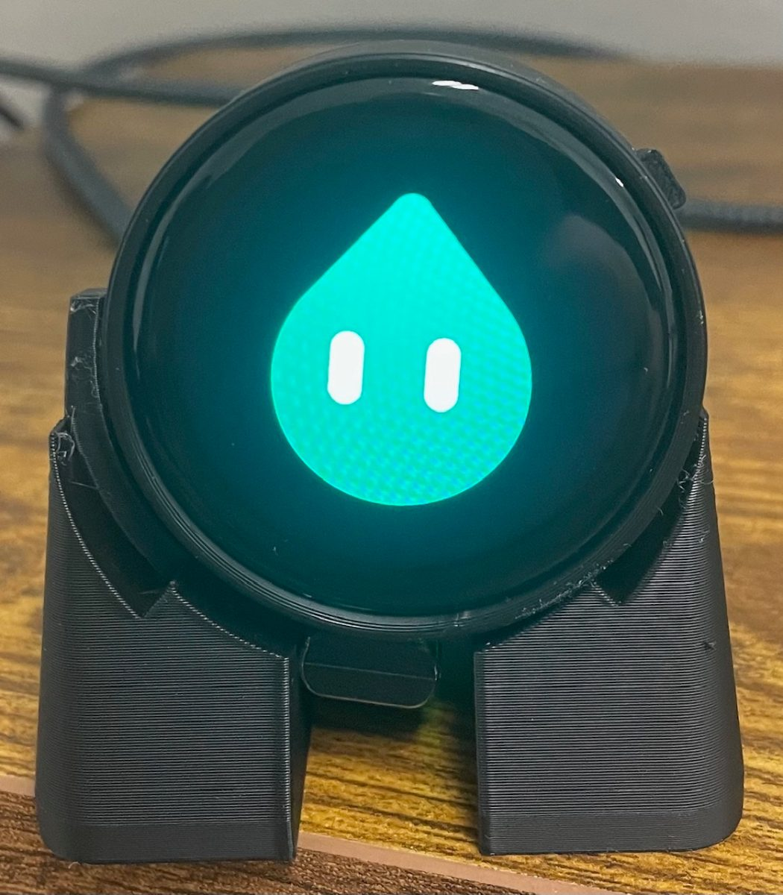
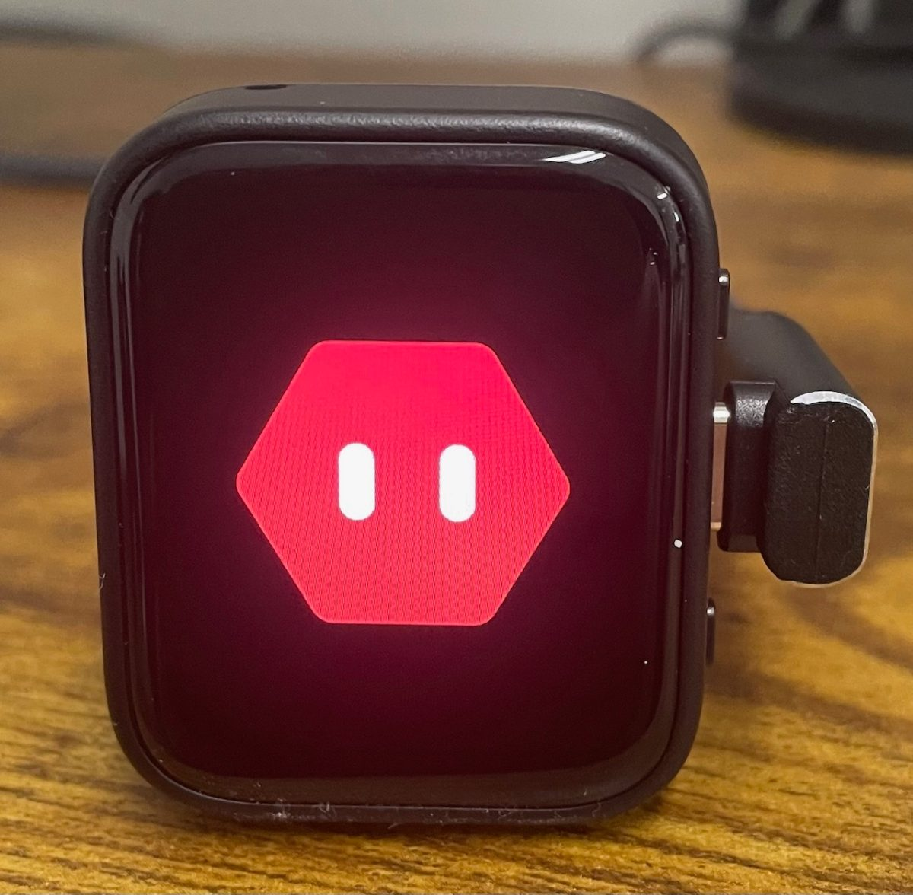

# Grok Puck

A desk display for Grok Bot: a small touch screen that **is** one of your Grok Bots, sitting on
your desk:

- it shows the bot's avatar (shape and colour as in the Grok Bot app), animated while the bot thinks
  and works;
- it **speaks everything the bot writes**, so you can follow it without keeping its window open (or
  plays it in a browser tab on your computer, for headphones: the Listen page);
- **hold it and speak** to answer, then let go: your words reach the bot as if you had typed them.

<p align="center">
  
  &nbsp;
  
</p>
<p align="center"><em>The two boards it runs on: the round LCD-1.46 in its printed case and stand, and the
AMOLED-1.8 in its own case.</em></p>

Grok Bot is the only "brain": there is no separate voice model or AI API to pay for. Speech-to-text and
text-to-speech come from any OpenAI-compatible service, including a self-hosted one.

An unofficial hobby project, not affiliated with or endorsed by xAI.

## How it works

```
Round screen  ⇄  bridge (your always-on machine, behind a Cloudflare Tunnel)  ⇄  Grok Bot
                      │                                                   webhook in, MCP tools out
                      └─ speech services (TTS, STT)
```

Grok Bot runs in the cloud: it can only take a webhook and call MCP tools on a public HTTPS address, and
the device sits on a home (or any) Wi-Fi. So a small **bridge** sits between them. It keeps one
connection to each device, turns speech into text and back, starts the bot's routine when you speak,
and gives the bot tools to speak (`desk_say`) and show what it is doing (`desk_status`). The full
design: [docs/spec.md](docs/spec.md).

## Status

| Part | State |
|---|---|
| [Bridge](bridge/) (TypeScript server + admin page) | working, with tests and a fake device / fake Grok Bot; its Listen page plays the bot's speech in a browser tab |
| [Firmware](firmware/) (ESP-IDF, Waveshare ESP32-S3-Touch-LCD-1.46 and ESP32-S3-Touch-AMOLED-1.8) | working: Wi-Fi setup from a phone with up to 5 saved networks (for travelling), approval, avatar and states, spoken replies, hold to talk |
| [Installer](installer/) (web page on GitHub Pages) and [releases](https://github.com/e-roy/grok-puck/releases) | released: v0.6.0 on 13 Nov 2026. Installs the firmware from the browser, keeping the device's settings |
| Grok Bot setup | working: MCP server, standing instructions and voice routine. Some checks still to run: [docs/grok-bot-setup.md](docs/grok-bot-setup.md) |
| [Case and stand](hardware/) (3D prints, for the LCD-1.46) | printed and fitting: the case, its button plungers and the 15° stand, as [ready-to-print files](hardware/waveshare-lcd-1.46/README.md#prints) |

## Getting started

**[Set up your own](docs/setup.md)**: one guide, in order, from the parts to a desk display that talks:

1. the parts, and printing the case and stand;
2. the bridge on an always-on machine with Docker, behind a Cloudflare Tunnel;
3. the speech services and your bot, in the bridge's admin page;
4. the device: installing its firmware from the browser with the
   [web installer](https://e-roy.github.io/grok-puck/) (Chrome, Edge or Firefox on a computer, no
   ESP-IDF needed), its Wi-Fi from your phone, approving it;
5. connecting Grok Bot;
6. talking to it.

To try it before buying anything, the bridge comes with a fake device and a fake Grok Bot:
[bridge/README.md](bridge/README.md#try-the-whole-loop-without-hardware-or-grok-bot).

## Hardware

- Waveshare **ESP32-S3-Touch-LCD-1.46** (with cover glass): 1.46" 412×412 round touch display,
  microphone, speaker, ESP32-S3 with Wi-Fi. With a right-angle USB-C cable for power, and a printed
  case and 15° desk stand (PLA): [hardware/waveshare-lcd-1.46/](hardware/waveshare-lcd-1.46/).
- Or the Waveshare **ESP32-S3-Touch-AMOLED-1.8**, a 368×448 AMOLED with microphone and speaker that
  comes in its own case: [hardware/waveshare-amoled-1.8/](hardware/waveshare-amoled-1.8/).

Each device's folder in [hardware/](hardware/) has its parts list with where to buy them, and, for the
LCD-1.46, the ready-to-print files, print settings and the OpenSCAD sources.

## Contributing

Contributions are welcome: see [CONTRIBUTING.md](CONTRIBUTING.md). In short:
- enable the privacy check once per clone (`git config core.hooksPath .githooks`);
- behaviour changes start in the spec;
- every pull request must pass four checks: bridge, docker, firmware and installer.

## Licence

MIT ([LICENSE](LICENSE)), for the code, the docs and the 3D files. Third-party code:
[THIRD_PARTY_NOTICES.md](THIRD_PARTY_NOTICES.md), with the notices for the published firmware and the
installer page.
