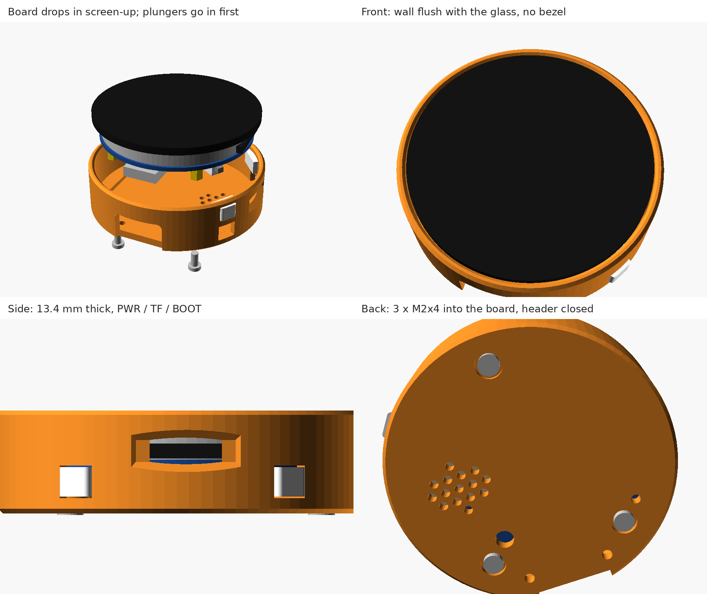
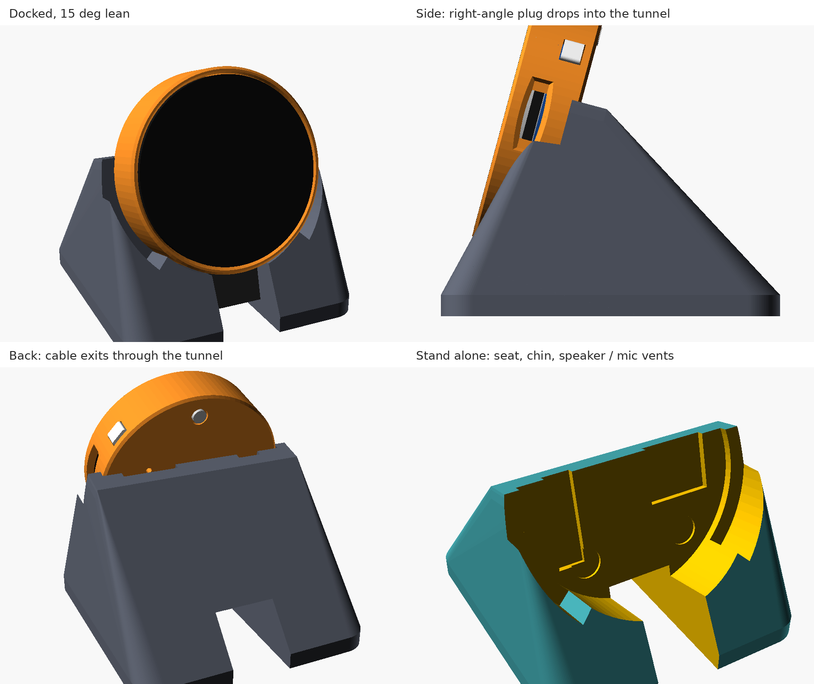

# Hardware

## Bill of materials

| Qty | Part | Notes |
|---|---|---|
| 1 | Waveshare **ESP32-S3-Touch-LCD-1.46**, cover-glass version | 1.46" 412×412 round touch display, ESP32-S3 (8 MB PSRAM, 16 MB flash), microphone, speaker |
| 3 | **M2×4** button-head hex-socket machine screws | slim case: through the back into the board's own brass standoffs. **Nothing longer than 4 mm**: an M2×4 ends about 1 mm short of the PCB |
| 1 | **90° up/down-angle USB-C cable** | the cable leaves the plug toward its front or back face, not sideways. The stand's slot is 15 mm wide, sized for a plug head of about 13 × 11 × 9 mm: check the head before buying |
| 1 | 5 V USB power supply | the device runs on USB power only |
| | PLA filament | case, stand, button plungers |

The earlier, larger case (`case-v1/`) uses **3 × M2×8 pan-head self-tapping screws** instead, into
2.1 mm pilot holes.

## Prints

All parts: PLA, 0.4 mm nozzle, 0.20 mm layers, no supports, oriented as exported.

### Slim case and stand (`case-slim/`, current design)




| File | What | Print |
|---|---|---|
| `lcd146_slim_gauge.stl` | four rings at 0.15 / 0.25 / 0.35 / 0.50 mm clearance around the 44.77 mm glass (dots = ring number) | first, about 10 min; only needed if a case comes out tight or loose |
| `lcd146_slim_case.stl` | one piece: back plate and a wall flush with the glass, 48.5 mm across, 13.4 mm thick; header covered | back face down |
| `lcd146_slim_button_set.stl` | PWR and BOOT plungers at three switch gaps (0.15 / 0.35 / 0.55 mm, marked 1 / 2 / 3 holes) | keep the pair that clicks cleanly without holding the button down |
| `lcd146_slim_stand.stl` | desk stand, 15° lean, 60 × 64 × 41 mm, screen centre 38 mm above the desk; the plug drops into a slot and the cable runs out through a tunnel | base down, **40 % infill or more**, so tapping the top of the screen doesn't tip it back |

**Assembly:** case face up → drop each plunger in from the inside, cap out through its window → lower
the board in, screen up, USB-C into the bottom notch → hold the board, turn the case over → 3 screws,
snug only. **Docking:** plug the cable in pointing back, lower the case into the stand so the plug drops
into the slot, lay the cable in the tunnel.

### Earlier, larger case (`case-v1/`)

A shell with a lip over the glass plus a back cover with a speaker grille and mic, LED and volume-knob
holes, 49.3 × 51.2 × 14.3 mm. This one has been printed and fits.

| File | Print |
|---|---|
| `lcd146_case_shell.stl` | lip face down |
| `lcd146_case_cover.stl` | back face down (pads and ribs up) |
| `lcd146_case_button_set.stl` | plungers at three switch gaps, as above (0.1 mm shorter than the slim set; not interchangeable) |

## Editing the models

Both cases are parametric OpenSCAD files. Every board position is a parameter at the top; set `part`
and export:

```sh
openscad -D 'part="case"'  -o case.stl  case-slim/esp32s3_lcd146_slim.scad   # case, button_set, gauge, stand
openscad -D 'part="shell"' -o shell.stl case-v1/esp32s3_lcd146_case.scad     # shell, cover, buttons, button_set, gauge
```

## Known issues

- **Nothing is measured yet.** Board positions come from Waveshare's dimension drawing: printed values,
  plus values scaled off its photo, about ±0.5 mm.
- **The TF-card window sits a little off** on the printed case: it should turn toward the USB-C
  connector. The angle is the `tf_ang` parameter (now 3°, counter-clockwise from 3 o'clock seen from the
  front; USB-C is at -90°). It must stay clear of the BOOT plunger window at -33°.
- **The slim case and stand haven't been printed yet.**
- The USB-C opening (13.5 × 8 mm) can shrink to the chosen cable's plug housing plus 0.5 mm.
- The `.scad` files were recovered from text listings and checked token for token. Some spacing inside
  comments may differ from the original, but the code is unchanged.
