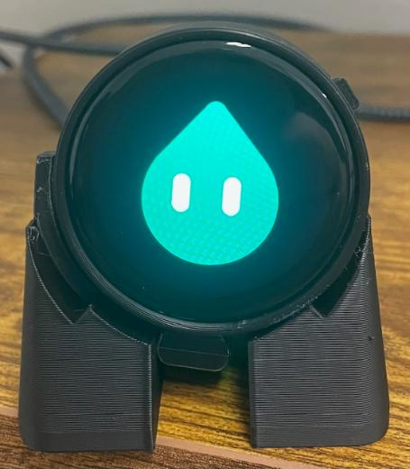

# Hardware

One folder per device, named like its firmware board (`firmware/boards/<id>`). Each holds what you
need to build that device: its parts and where to buy them, and, if it needs printing, the files to
print, how to put it together and the OpenSCAD sources. Each device also has its own firmware build
and its own Install button on the [installer page](https://e-roy.github.io/grok-puck/) (spec §4.8).

| Device | Needs printing? | Its folder |
|---|---|---|
|  Waveshare **ESP32-S3-Touch-LCD-1.46** (cover-glass version): round, 1.46" 412×412 | yes: a case, two button plungers and a desk stand | [waveshare-lcd-1.46/](waveshare-lcd-1.46/) |
|  Waveshare **ESP32-S3-Touch-AMOLED-1.8**: rectangular, 1.8" 368×448 AMOLED | no: it comes in its own case | [waveshare-amoled-1.8/](waveshare-amoled-1.8/) |

## Printing

For every printed part:

- PLA, 0.4 mm nozzle, 0.20 mm layers (a "0.20 mm Standard" profile), no supports;
- each part oriented as exported: the files are laid out the way they print;
- small parts that show, such as button plungers, are easier to find in a contrasting colour.

The device's README says which face of each part goes down, and which parts need more infill.

## What a device's folder holds

- `README.md`: its bill of materials, what to print and how, assembly, editing the models, known
  issues;
- `print/`: the STL files, ready to print;
- `source/`: the parametric OpenSCAD sources they are exported from;
- `images/`: `photo.jpg` for the READMEs, and `photo-small.jpg` for its card on the installer page,
  both without metadata.

Adding a device, or changing a build: [CONTRIBUTING.md](../CONTRIBUTING.md#the-devices-hardware).
