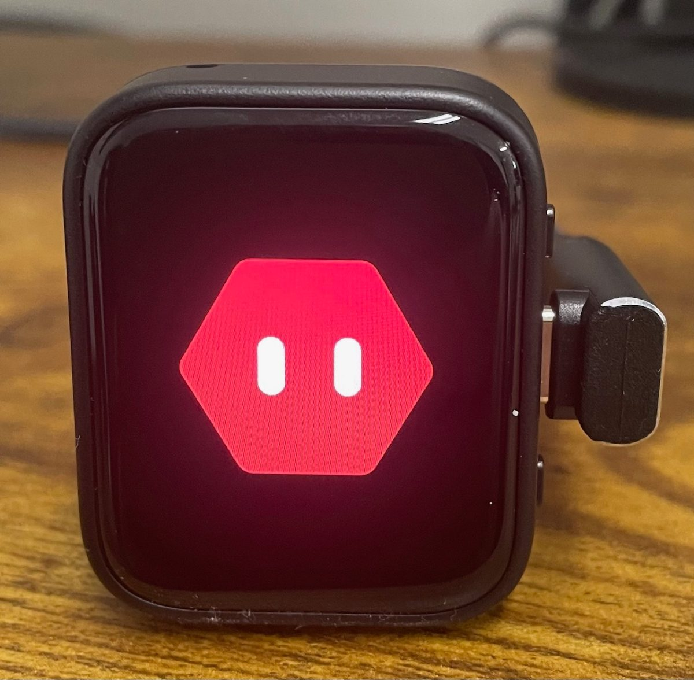

# Waveshare ESP32-S3-Touch-AMOLED-1.8

A 1.8" 368×448 AMOLED touch display, upright and not round, in a black case. It **comes in its own
case: nothing to print.** Its firmware board is `waveshare-amoled-1.8`, with its own Install button on
the [installer page](https://e-roy.github.io/grok-puck/) (spec §4.8). Its name is on the label on its
back.

## Bill of materials

| Qty | Part | Notes | Where to buy |
|---|---|---|---|
| 1 | Waveshare **ESP32-S3-Touch-AMOLED-1.8** | 1.8" 368×448 AMOLED touch display (not round), ESP32-S3 (8 MB PSRAM, 16 MB flash), ES8311 codec with microphone and speaker, in a black case. The version without a battery is enough: the device runs on USB power | [Amazon](https://www.amazon.com/dp/B0DSVK5576?tag=grok-puck-20) (the version without a battery) |
| 1 | Any USB cable that carries data | USB-C at the board's end. Installing the firmware needs one that carries data, not just power | any |
| 1 | 5 V USB charger | the device runs on USB power only | any |

As an Amazon Associate I earn from qualifying purchases.

## What's supported

Supported: on a V2 board in its case, the face, touch, speaking and listening, and Wi-Fi setup work
with an always-on bridge and real speech services. Whether it needs a stand on the desk isn't decided
yet.

## V1 and V2

Waveshare makes two versions of this board, and one firmware build runs on both:

- **V1**: SH8601 display and FT3168 touch;
- **V2** (from 30 May 2026): CO5300 display and CST820 touch.

Only V2 is tested so far. The board also has an AXP2101 power manager (a battery connector and a PWR
button) and a TCA9554 I/O expander for the display's and touch's resets (spec §4.8).
