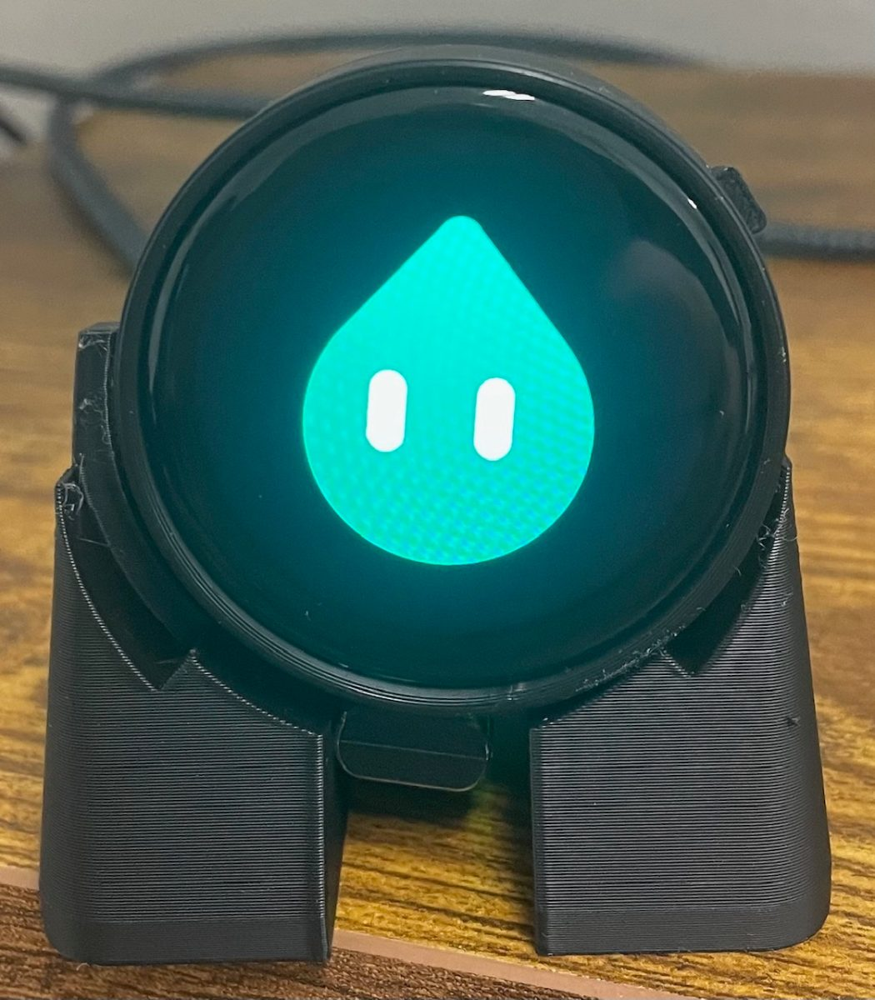

# Waveshare ESP32-S3-Touch-LCD-1.46



The round board, in a printed case with two button plungers, on a printed desk stand. Its firmware
board is `waveshare-lcd-1.46`. **Current builds:** the case **v2**, the plungers **v5** and the stand
**v1** (15°), printed and tested together.

## Bill of materials

| Qty | Part | Notes | Where to buy |
|---|---|---|---|
| 1 | Waveshare **ESP32-S3-Touch-LCD-1.46**, cover-glass version | 1.46" 412×412 round touch display, ESP32-S3 (8 MB PSRAM, 16 MB flash), microphone, speaker | [Amazon](https://www.amazon.com/dp/B0DS83H2V6?tag=grok-puck-20) |
| 3 | **M2×4** button-head hex-socket machine screws | through the case's back into the board's own brass standoffs. **Nothing longer than 4 mm**: an M2×4 ends about 1 mm short of the PCB, and an M2×6 is too long. From an M2 assortment (MYWISH, 800 pieces, 304 stainless steel, M2×4 to M2×20) | [Amazon](https://www.amazon.com/dp/B0CTJY6G5K?tag=grok-puck-20) (the assortment) |
| 1 | **USB-A to USB-C cable, 90° up/down angle**, 10 ft | the cable leaves the plug toward its front or back face, not sideways. This one fits the stand's slot (a little stiff). For another cable: the slot is 15 mm wide, sized for a plug head of about 13 × 11 × 9 mm, so check the head before buying. Installing the firmware needs a cable that carries data: if this one only charges, any other USB cable that carries data works for installing | [Amazon](https://www.amazon.com/dp/B0H24WF65K?tag=grok-puck-20) |
| 1 | **5 V 2.1 A USB-A charger** | the device runs on USB power only; USB-A, for the cable above. Tested: a LUOATIP cube charger | [Amazon](https://www.amazon.com/dp/B07TK6MPNB?tag=grok-puck-20) (a 3-pack) |
| | PLA filament | case, button plungers, stand. Plungers in a contrasting colour make the buttons easy to find | any PLA |

As an Amazon Associate I earn from qualifying purchases.

## Prints

The files are in [print/](print/). Every part: PLA, 0.4 mm nozzle, 0.20 mm layers, no supports,
oriented as exported ([printing notes](../README.md#printing)).

| File | What it is | Version | Orientation and settings |
|---|---|---|---|
| [lcd146_case.stl](print/lcd146_case.stl) | The case: one piece, a back plate and a wall flush with the glass, 48.5 mm across and 13.4 mm thick. The board screws into the back plate through its own three brass standoffs. The 2×10 header is covered; there is no TF-card window; the PWR and BOOT plungers sit in 6.0 mm windows | v2 | back face down |
| [lcd146_button_plungers.stl](print/lcd146_button_plungers.stl) | The PWR and BOOT plungers, one pair (both the same). Their caps stand 1.5 mm out of the case wall | v5, with the inner face 1.0 mm further in: the length that works | flat, as exported. A contrasting colour makes the buttons easy to find |
| [lcd146_stand.stl](print/lcd146_stand.stl) | The desk stand: 15° lean, 60 × 64 × 41 mm, screen centre 38 mm above the desk. For a 90° up/down-angle USB-C cable: the plug drops into a 15 mm slot and the cable runs out the back through a tunnel. The cable in the bill of materials fits | v1, 15° | base down, **40 % infill or more**, so tapping the top of the screen doesn't tip it back |
| [lcd146_glass_fit_gauge.stl](print/lcd146_glass_fit_gauge.stl) | *Optional, not part of the build:* four short rings at 0.15 / 0.25 / 0.35 / 0.50 mm clearance around the 44.77 mm cover glass (dots on top = ring number). The case uses 0.25 mm, which fits | | lip down (about 10 minutes). Only if a case comes out tight or loose around the glass: then set `glass_clr` to the tightest ring the glass drops into and sits flat in |

**Also needed:** 3 × M2×4 button-head machine screws. Nothing longer than 4 mm: an M2×6 is too long.

## Assembly

1. Case face up on the desk. Drop each plunger in from the inside and push its cap out through its
   window (the PWR and BOOT plungers are the same part).
2. Lower the board in, screen up, with its USB-C connector in the notch at the bottom.
3. Hold the board in, turn the case over, and screw the 3 M2×4 screws through the back into the
   board's standoffs: snug only, and nothing longer than 4 mm.
4. Press both buttons: each should click and spring back.

**Docking:** plug the cable in with the cable pointing back, lower the case into the stand so the plug
drops into the slot, and lay the cable in the tunnel.

## Editing the models

Two parametric OpenSCAD sources (written with OpenSCAD 2021.01), in [source/](source/). Every board
position is a parameter at the top, marked with where it comes from: **[MEAS]** measured with
calipers on a real board, **[DWG]** Waveshare's dimension drawing, **[IMG]** scaled off that
drawing's photo (about ±0.5 mm).

- [esp32s3_lcd146_slim.scad](source/esp32s3_lcd146_slim.scad), the current source: the case
  (`part="case"`), the plungers (`part="button_pair"`) and the gauge (`part="gauge"`). With its
  parameters as they are, it builds the case and plungers in print/. Its `stand()` is a tilted 25/30°
  option, not the stand in print/.
- [esp32s3_lcd146_slim_v1_stand.scad](source/esp32s3_lcd146_slim_v1_stand.scad), the first version,
  kept only for the stand (`part="stand"`). Its case and plungers are the older design.

```sh
cd hardware/waveshare-lcd-1.46
openscad -D 'part="case"'        -o print/lcd146_case.stl            source/esp32s3_lcd146_slim.scad
openscad -D 'part="button_pair"' -o print/lcd146_button_plungers.stl source/esp32s3_lcd146_slim.scad
openscad -D 'part="gauge"'       -o print/lcd146_glass_fit_gauge.stl source/esp32s3_lcd146_slim.scad
openscad -D 'part="stand"'       -o print/lcd146_stand.stl           source/esp32s3_lcd146_slim_v1_stand.scad
```

The parameters most likely to change: `glass_clr` (the gap around the glass: 0.25 mm, which fits),
`nub_len` (how far the plungers reach in: 1.0 mm works; 1.5, 2.0 and 2.5 were also made) and `pwr_ang`
(the PWR window's angle). The `check_...` parts are interference checks: each should come out empty.
Both files were rebuilt from verbatim text listings of the sources and checked token for token.

A changed build replaces its file in print/ under the same name; its new version goes in the Prints
table and in **Current builds** above.

## Known issues

- **The case, plungers and stand have been printed and tested** with the parts in the bill of
  materials: the cable fits the stand's slot, and the case takes M2×4 screws (M2×6 are too long).
- **The board is partly measured.** The heights that set the case's depth were measured with calipers
  on a real board ([MEAS]: from the glass front, 10.6 mm to the back of the standoffs, 7.2 mm to the
  PCB's back, 11.8 mm to the header pin tips, 8.2 mm to the PWR push part). Positions across the board
  (the standoff pattern, the button and USB-C angles, the speaker, mic and LED holes) still come from
  Waveshare's drawing ([DWG], [IMG]).
- **The PWR window was checked only on a board whose PWR switch may be damaged** (a misaligned plunger
  in an earlier test case jammed on it). Its position (`pwr_ang` 37.5°, the v2 case) works on that
  board; check it on a new one. The source notes an untested alternative at 35.6°. The BOOT window
  lines up and works.
- **The plungers are tested:** the v5 pair clicks and springs back. Earlier plungers slid in without
  clicking: on the real board the switches sit further in than the drawing showed.
- **The current source's `stand()` is an untested option** that leans 25 or 30°. The stand in print/
  is the original 15° one, from the v1 source.
- The USB-C opening (13.5 × 8.8 mm) is sized for the plug's overmold; it could shrink to the chosen
  cable's plug housing plus 0.5 mm.
